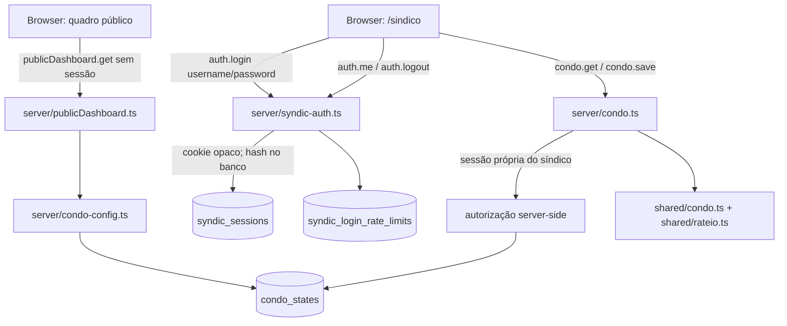

# Arquitetura

## Princípios

O sistema é uma aplicação React/TypeScript com servidor Express/tRPC e persistência MySQL/Drizzle. A raiz exibe um quadro público anônimo; `/sindico` é a única área privada. A autorização privada é decidida no servidor a partir da sessão opaca própria do síndico e do único estado de condomínio configurado. O navegador não escolhe `ownerId`, papel ou unidade autorizada.

O estado financeiro continua sendo um documento validado por `condoStateSchema`, com `revision` e persistência aditiva. Os módulos novos observados no working tree são `server/syndic-auth.ts`, `server/publicDashboard.ts`, `shared/syndic.ts` e `shared/public-dashboard.ts`. A integração final dos procedimentos, rotas e migrações deve ser confirmada na validação; esta documentação não transforma a presença de um arquivo em prova ponta a ponta.

## Componentes



Não há ramo OAuth para autorizar o aplicativo, nem ramo de convite/morador. A visibilidade da plataforma é uma configuração independente: uma URL pública acessível não concede edição, e um Preview não deve ser tratado como publicação.

### Componentes e responsabilidades

| Componente | Responsabilidade |
| --- | --- |
| `client/` | Interface pública e área do síndico; não guarda credencial nem decide autorização. |
| `client/src/components/condo/rateio-panel.tsx` | Prévia, método, snapshot, ativação/atualização e limpeza do rateio. |
| `server/_core/index.ts` | Inicialização Express, tRPC, Vite/arquivos compilados e `/api/health`. |
| `server/_core/context.ts` | Contexto com sessão própria opcional; cookie Manus não é autorização de condomínio. |
| `server/_core/trpc.ts` | Procedimentos públicos e protegidos pela sessão do síndico. |
| `server/routers.ts` | `auth`, `publicDashboard`, `condo` e demais rotas ainda permitidas pelo contrato; não montar portal/convite. |
| `server/syndic-auth.ts` | Login `admin`, comparação `scrypt`, sessão opaca, expiração, logout e rate limit. |
| `server/publicDashboard.ts` | Projeção mínima da competência mais recente para o quadro público. |
| `server/condo.ts` | `condo.get`, `condo.save`, revisão e proteção de competência fechada. |
| `server/condo-config.ts` | Resolução única do condomínio configurado; estado ambíguo não escolhe a primeira linha. |
| `shared/condo.ts` | Schemas e cálculo de cobrança/mês. |
| `shared/rateio.ts` | `allocateCents`, `calculateExpenseAllocation`, `makeAllocationConfig` e detecção de alteração. |
| `shared/syndic.ts` | `SYNDIC_USERNAME`, caminho `/sindico`, `SyndicIdentity` e tipos de sessão. |
| `shared/public-dashboard.ts` | DTO público e categorias permitidas. |
| `drizzle/schema.ts` | `users`/estado legado, `condo_states` e tabelas aditivas da sessão e do rate limit. |

`server/access.ts`, `shared/access.ts`, `condo_memberships` e `condo_invites` podem permanecer para compatibilidade e histórico. Eles não são fonte de autorização atual e não devem voltar a montar login OAuth, convite ou portal de morador.

## Persistência

A tabela `condo_states` continua tendo uma linha por `ownerId`, `revision`, estado JSON e timestamps. A nova sessão própria usa a tabela aditiva `syndic_sessions`, com identificador, `ownerId`, `tokenHash`, `expiresAt` e timestamp de criação. O token cru não é persistido. A tabela aditiva `syndic_login_rate_limits` mantém contadores por escopo global e por IP, sem senha ou token.

A sessão é um token aleatório de 32 bytes (256 bits), representado para transporte por 64 caracteres hexadecimais. O servidor calcula SHA-256 para lookup/revogação, usa cookie `httpOnly`/`secure` conforme o proxy e define expiração de oito horas. O segredo de senha vem de `CONDO_ADMIN_PASSWORD` em runtime; não há valor padrão no código ou no repositório.

Registros legados em `condo_memberships` e `condo_invites` não devem ser apagados por esta mudança, mas também não podem conceder acesso. Qualquer migração nova deve ser aditiva, revisada e aplicada uma vez, preservando estado financeiro, unidades, cobranças, pagamentos e histórico.

## APIs do contrato atual

Em tRPC, os nomes abaixo são namespaces na raiz de `appRouter`. As rotas devem ser públicas somente quando indicado.

| Procedimento | Acesso | Entrada | Saída/efeito |
| --- | --- | --- | --- |
| `auth.login` | público | `{ username: string; password: string }` | `{ success: true }` e criação de sessão própria quando as credenciais forem válidas; erro genérico para credencial inválida. |
| `auth.me` | público | nenhuma | `null` ou `SyndicIdentity` da sessão própria; nunca identidade Manus ou de morador. |
| `auth.logout` | público | nenhuma | `{ success: true }`, revoga a sessão própria e limpa o cookie correspondente. |
| `publicDashboard.get` | público | nenhuma | `PublicDashboard` mínimo da competência mais recente; não varia com cookie admin. |
| `condo.get` | sessão própria do síndico | nenhuma | estado e `revision` do condomínio configurado, para uso dos painéis privados. |
| `condo.save` | sessão própria do síndico | `{ revision, state }` | estado validado, nova revisão e acesso de síndico; rejeita ausência/alteração de sessão, conflito e conteúdo fechado. |
| `GET /api/health` | público | nenhuma | saúde HTTP básica; não prova autorização. |

A superfície não deve montar `access.list`, `access.createInvite`, `access.acceptInvite`, `access.revokeMember`, `access.revokeInvite`, `/convite/:token` ou portal de morador como fluxos de acesso. Se módulos legados ainda exportarem esses símbolos, isso é compatibilidade histórica, não contrato de autorização.

### DTO público

O tipo compartilhado permitido é:

```ts
type PublicDashboard = {
  name: string;
  apartmentCount: number;
  latest: {
    competence: string;
    status: "open" | "closed";
    totalExpensesCents: number;
    expenses: Array<{
      id: string;
      description: string;
      category: "Água" | "Gás" | "Manutenção" | "Limpeza" | "Administração" | "Outros";
      date: string;
      amountCents: number;
    }>;
    categories: Array<{
      category: "Água" | "Gás" | "Manutenção" | "Limpeza" | "Administração" | "Outros";
      amountCents: number;
    }>;
  } | null;
};
```

Não incluir `ownerId`, `revision`, `units`, nomes, contatos, leituras, `charges`, pagamentos privados, multas individuais, memberships, convites, sessão, token ou hash. `apartmentCount` é uma contagem agregada; `totalExpensesCents` e as categorias referem-se somente a `latest.expenses`.

### Seleção da competência pública

`server/publicDashboard.ts` deve selecionar a maior string `competence` no formato `YYYY-MM`, incluindo competência aberta. O critério não é “mês anterior”, “último fechamento” ou ordem de inserção. Sem meses, `latest` é `null` e não se deve serializar a competência literal do estado inicial como se fosse um lançamento real. Uma configuração ambígua deve retornar indisponibilidade, não escolher a primeira linha.

## Autenticação e fronteira de autorização

O fluxo de login usa apenas `CONDO_ADMIN_PASSWORD`, usuário fixo `admin`, derivação `scrypt` e comparação em tempo constante. A senha configurada nunca é retornada ao client, logada ou incluída na documentação. Falha de segredo ausente deve impedir login; credenciais erradas usam resposta genérica. O limitador deve bloquear após cinco falhas por janela de quinze minutos tanto no escopo global quanto no escopo do IP, com resposta sem enumeração de usuário.

`condo.get` e `condo.save` devem resolver a sessão própria no contexto (`ctx.syndic` ou equivalente) e conferir o `ownerId` do estado configurado no servidor. Cookie Manus, `ctx.user`, `ownerId` enviado pelo navegador, role de plataforma, membership ou convite legado não substituem essa verificação.

## Rateio e composição

`Month` pode conter `allocation` opcional. Cada `Expense` pode conter `rateable` opcional. `calculateExpenseAllocation` só inclui `rateable === true`, e sem `allocation` retorna total e parcelas zero. `calculateCharge` soma `sharedCents` separadamente de água, gás, condomínio, reserva, multa e outros. A prévia do client não substitui a validação do estado e o controle de competência fechada no servidor.

O cálculo de consumo usa aritmética inteira segura com BigInt (`(consumoMilli × tarifaCents + 500) / 1000`), evitando erro de ponto flutuante em reais. O rateio usa centavos inteiros, maiores restos e desempate estável pelo `unitId`.

## Fluxo de rateio

```text
competência aberta
  -> selecionar método e participantes
  -> capturar pesos/frações como snapshot
  -> marcar despesas rateáveis
  -> calcular prévia por despesa e unidade
  -> conferir duplicidade de água/gás e soma exata
  -> confirmar no servidor por condo.save
  -> mostrar sharedCents em cobrança, extrato e relatório privado
competência fechada
  -> não aceita edição financeira; reabrir explicitamente antes de alterar
```

A alteração cadastral de fração ou a desativação de unidade não reescreve snapshots históricos. Atualizar participantes/pesos é ação explícita e deve ficar restrita à competência aberta.
